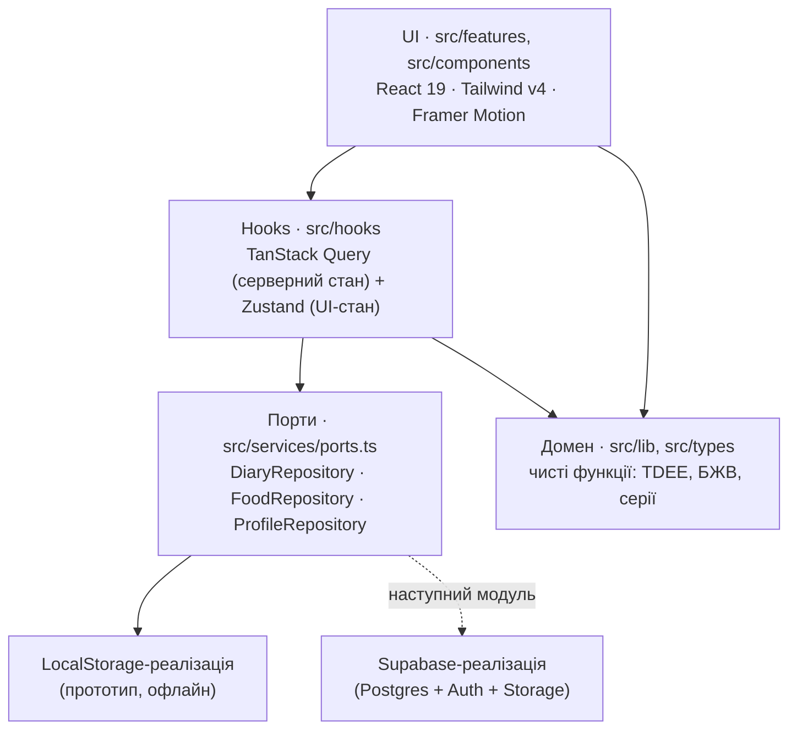
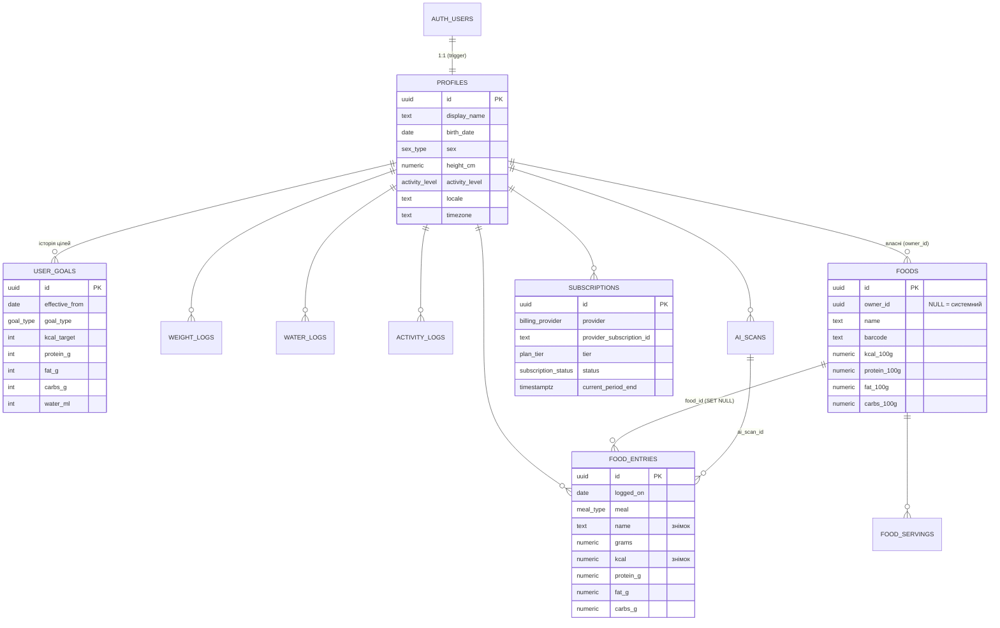

# Vitalio — архітектура

Web-first (PWA) застосунок для підрахунку калорій і БЖВ. Той самий код збирається у веб, PWA та нативні
застосунки App Store / Google Play через **Capacitor** — без переписування.

## Схема шарів



**Ключові рішення**

| Рішення | Чому |
| --- | --- |
| Репозиторії-порти + composition root (`src/services/index.ts`) | Перехід на Supabase = заміна трьох рядків, UI не змінюється (Dependency Inversion). |
| TanStack Query для даних, Zustand лише для UI | Немає дублювання джерел правди; оптимістичні оновлення води/видалення вже працюють. |
| Знімок нутрієнтів у `food_entries` | Редагування бази продуктів не переписує історію користувача. |
| Домен — чисті функції з тестами (`vitest`) | Формула Міффліна — Сан Жеора, БЖВ, серії перевіряються без UI. |
| Словник `src/i18n/uk.ts` + тип `Dictionary` | Нова мова = один файл, що реалізує той самий тип; помилки пропущених ключів ловить TypeScript. |
| Семантичні токени (`--surface`, `--ink`, `--brand`…) | Світла/темна теми та бренд змінюються в одному місці (`globals.css`). |

## Структура папок

```text
.
├── capacitor.config.ts          # appId, webDir: out, Safe Area
├── next.config.ts               # BUILD_TARGET=mobile → output: "export"
├── public/
│   ├── manifest.webmanifest     # PWA
│   ├── sw.js                    # офлайн-оболонка (stale-while-revalidate)
│   └── icons/
├── supabase/migrations/0001_init.sql   # схема БД + RLS + Storage
├── docs/ARCHITECTURE.md
└── src/
    ├── app/
    │   ├── layout.tsx           # viewport-fit=cover, theme-color, шрифти
    │   ├── providers.tsx        # next-themes, React Query, i18n, service worker
    │   ├── globals.css          # дизайн-токени + Tailwind v4 @theme
    │   └── (app)/               # оболонка з навігацією
    │       ├── layout.tsx
    │       ├── page.tsx         # Дашборд
    │       └── diary|progress|profile/page.tsx   # заглушки (наступні модулі)
    ├── components/
    │   ├── ui/                  # Button, Card, ProgressRing, BottomSheet, Toaster…
    │   ├── layout/              # AppShell, BottomNav, Sidebar, ThemeToggle
    │   └── brand/
    ├── features/
    │   ├── dashboard/           # bento-картки, календар, прийоми їжі
    │   └── food-log/            # Bottom Sheet: пошук → вага → додати
    ├── hooks/                   # use-diary (мутації), use-app-data (запити)
    ├── services/                # порти + локальні реалізації + демо-дані
    ├── stores/ui-store.ts       # Zustand: дата, sheet, тости
    ├── lib/                     # nutrition, date, streak, format, cn
    ├── i18n/                    # uk.ts + провайдер
    ├── data/foods.ts            # демо-база продуктів
    └── types/domain.ts
```

## Web → App Store / Google Play (Capacitor)

1. **Статичний експорт.** `npm run build:mobile` ставить `BUILD_TARGET=mobile`, і `next.config.ts` вмикає
   `output: "export"` → папка `out/`. Для цього в UI-шарі немає Route Handlers, Server Actions, `next/image`-оптимізатора
   чи middleware. Бекенд — Supabase (клієнтський SDK) та Edge Functions.
2. **Нативні проєкти.** Один раз: `npx cap add ios` і `npx cap add android`. Далі `npm run cap:ios` /
   `npm run cap:android` збирають експорт, синхронізують його в нативний проєкт і відкривають Xcode / Android Studio.
3. **Safe Area.** `viewport-fit=cover` + змінні `--safe-top` / `--safe-bottom` (`env(safe-area-inset-*)`).
   Нижня панель, Bottom Sheet, тости й відступи контенту враховують «чубчик» та home indicator.
   У `capacitor.config.ts` `ios.contentInset = "never"` — відступи віддано CSS.
4. **Нативні відчуття.** Свайп-для-видалення та drag-to-dismiss Bottom Sheet працюють на pointer events
   (Framer Motion) — однаково у браузері й WebView; `overscroll-behavior` вимкнено, `touch-action: manipulation`
   прибирає затримку тапу.
5. **Що додати перед публікацією:** `@capacitor/splash-screen`, `@capacitor/status-bar`, `@capacitor/camera`
   (сканер штрихкодів/AI), `@capacitor/haptics`, PNG-іконки 1024×1024; Sign in with Apple (вимога App Store при
   наявності Google-входу); для підписок у сторах — IAP (Apple/Google) замість Stripe.

## Схема бази даних

Повний SQL — [`supabase/migrations/0001_init.sql`](../supabase/migrations/0001_init.sql).



**Безпека та SaaS**

- RLS увімкнено на всіх таблицях; користувач бачить лише свої рядки (`user_id = auth.uid()`).
- Системні продукти (`owner_id IS NULL`) може писати лише `service_role`; користувацькі — тільки власник і лише `is_verified = false`.
- `subscriptions` і `billing_events` пишуться тільки вебхуками (Stripe / LemonSqueezy / Apple / Google) через `service_role`;
  `billing_events (provider, event_id)` забезпечує ідемпотентність.
- `user_entitlements` — представлення «Free чи Pro»; квоти AI-сканів рахуються з `ai_scans`.
- Фото страв — приватний bucket `meal-photos`, доступ лише до папки `<user_id>/`.
- `daily_summaries` та `current_streak()` — агрегати для дашборду й аналітики на стороні БД.

## Дорожня карта модулів

1. **Дашборд** ✅ (цей крок)
2. Онбординг + калькулятор TDEE (формула вже в `lib/nutrition.ts`)
3. Логіка додавання їжі: штрихкод, AI-сканер
4. База даних + Auth (Supabase-репозиторії, Google/Apple/Email)
5. Paywall + Stripe/LemonSqueezy
6. Аналітика та прогрес (вага, тижні/місяці)
